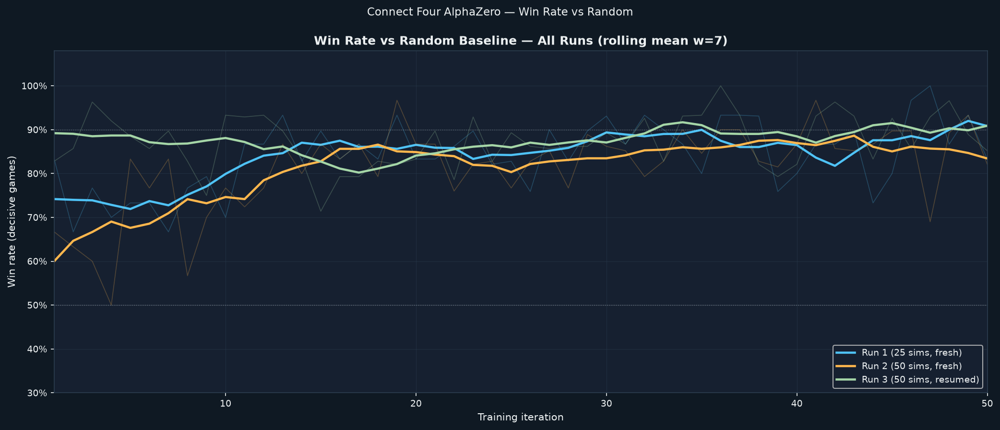
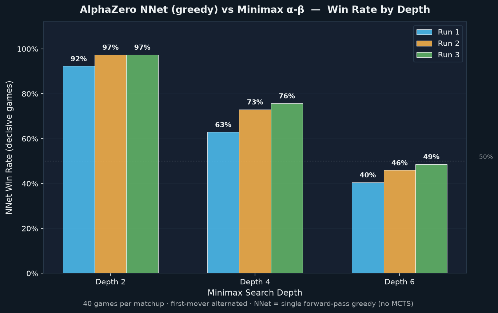
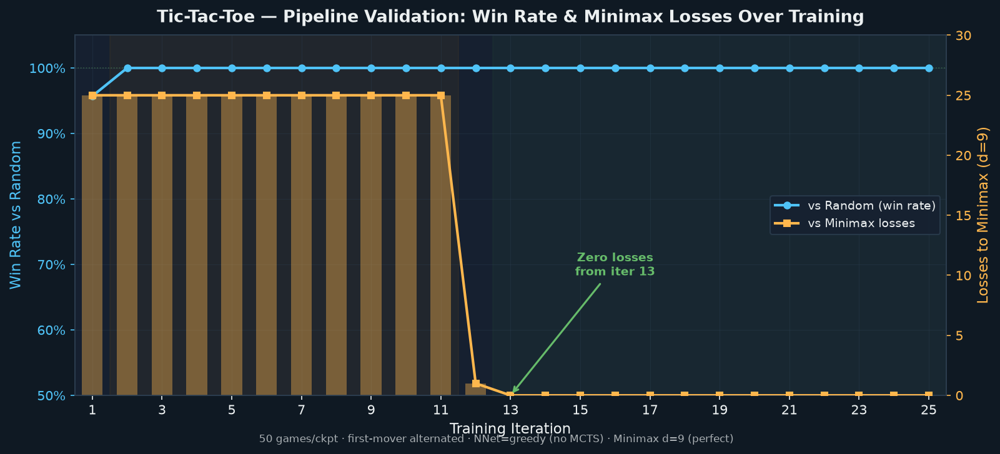
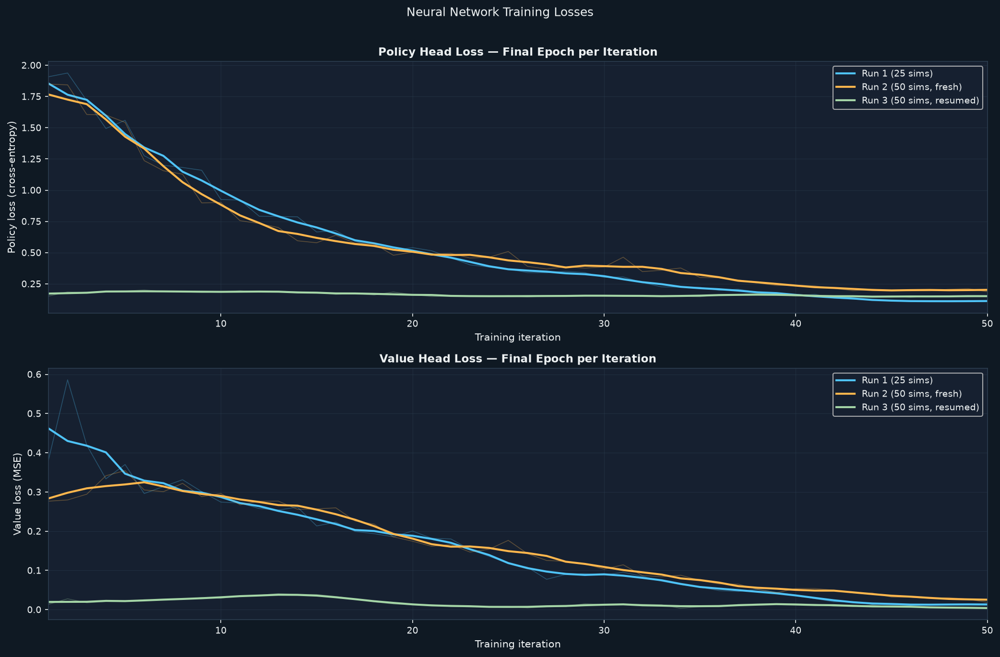
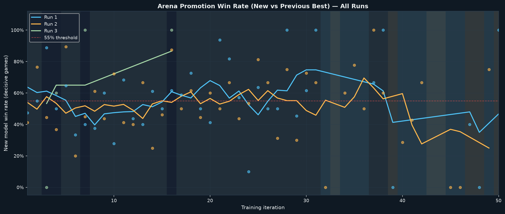

# Connect Four — AlphaZero Reimplementation

> A tabula rasa reinforcement learning system for Connect Four using Monte Carlo Tree Search (MCTS) guided by a deep convolutional neural network, trained via self-play on Apple Silicon (MPS).

---

## 📌 Project Overview

This project reimplements the core **AlphaZero** algorithm (*Silver et al., 2017*) for the game of **Connect Four**, with cross-game pipeline validation on **Tic-Tac-Toe**. The system learns to play entirely from scratch without opening books, human game records, or domain-specific evaluation heuristics.

### Key Highlights
- **Tabula Rasa Learning**: Self-play learning starting from uniform random initialization. The final model achieves **>88% average win rate vs. a random baseline** and **97.4% vs. Depth-2 Minimax**.
- **Classical Minimax Benchmark**: Benchmarked against an independent alpha-beta pruning minimax player with streak-counting heuristics at search depths 2, 4, and 6. A single forward pass of the raw policy network plays at roughly the tactical strength of a 5-ply minimax search.
- **Pipeline Generalization**: Validated on an independent implementation of Tic-Tac-Toe with $D_4$ dihedral symmetries, converging from 25 losses to **zero losses (50/50 draws)** against perfect minimax play.
- **Interactive UI**: A full-featured Streamlit application (`src/ui/app.py`) with 3 modes: human play with real-time value/policy diagnostics, AI vs AI live matches with auto-play, and move-by-move match transcript replays.
- **Apple Silicon Native**: Optimized for macOS on Apple Silicon using PyTorch's Metal Performance Shaders (`mps`) backend.

---

## 📂 Repository Layout

The codebase strictly maintains a clean architectural boundary between the external base framework and self-implemented modules:

```text
├── reference-repo/                # Unmodified base framework (suragnair/alpha-zero-general)
│   ├── Game.py                    # Abstract base Game interface
│   ├── NeuralNet.py               # Abstract base NeuralNet interface
│   ├── MCTS.py                    # Monte Carlo Tree Search with PUCT selection
│   ├── Coach.py                   # Self-play, training, and arena evaluation loop
│   ├── Arena.py                   # Two-player head-to-head match runner
│   └── utils.py                   # Utility functions (dotdict)
│
├── src/                           # Self-implemented components
│   ├── games/
│   │   ├── connect_four.py        # 6×7 Connect Four Game (gravity, win/draw detection, horizontal flip)
│   │   └── tic_tac_toe.py         # 3×3 Tic-Tac-Toe Game (D4 dihedral symmetry group)
│   ├── nets/
│   │   ├── connect_four_nnet.py   # 4-block ConvNet + dual heads (1.85M params, MPS support)
│   │   └── tictactoe_nnet.py      # 3-block ConvNet + dual heads (249K params)
│   ├── eval/
│   │   ├── minimax_player.py      # Classical alpha-beta minimax agent with domain heuristics
│   │   ├── eval_vs_minimax.py     # Evaluation harness for checkpoints vs. minimax depths 2/4/6
│   │   ├── eval_tictactoe.py      # Benchmark runner for Tic-Tac-Toe vs. random and minimax
│   │   └── game_runner.py         # Independent evaluation runner (RandomAgent, NNetGreedyAgent)
│   ├── ui/
│   │   ├── app.py                 # Interactive Streamlit UI (3 modes)
│   │   └── verify_ui_logic.py     # Automated end-to-end headless verification for UI modes
│   ├── scripts/
│   │   └── generate_report_assets.py # Generates figures and transcripts for REPORT.md
│   ├── results/                   # Evaluation results, tables, transcripts, and plots
│   ├── logs/                      # Training logs for Run 1, Run 2, Run 3, and Tic-Tac-Toe
│   ├── train_connect_four.py      # Connect Four training entry point (TimedCoach)
│   ├── train_tictactoe.py         # Tic-Tac-Toe training entry point
│   └── REPORT.md                  # Comprehensive empirical research report
│
├── checkpoints/                   # Saved model weights (.pth.tar) across runs
├── tests/                         # Pytest test suite for games, networks, and minimax
├── Makefile                       # Command shortcuts (setup, test, train, evaluate, ui, report)
├── pytest.ini                     # Pytest test discovery configuration
└── requirements.txt               # Pinned dependencies
```

---

## ⚡ Setup for Apple Silicon (MPS)

### Prerequisites
- macOS on Apple Silicon (M1/M2/M3/M4)
- Python 3.10+ (tested on Python 3.11)

### Installation
Clone the repository and set up a Python virtual environment:

```bash
# Create and activate virtual environment
python3 -m venv .venv
source .venv/bin/activate

# Install pinned dependencies
make setup
# Alternatively: pip install -r requirements.txt
```

### Verify MPS Acceleration
Run this quick check to confirm PyTorch detects your Apple Silicon GPU:

```bash
python -c "import torch; print('MPS available:', torch.backends.mps.is_available())"
```
*(Should print `MPS available: True`)*

---

## 🚀 Commands & Usage

All primary workflows are automated through the [`Makefile`](file:///Users/adityakachhot/RL%20project/Makefile):

| Task | Make Target | Direct Command |
|---|---|---|
| **Run Unit Tests** | `make test` | `pytest tests/` |
| **Launch Web UI** | `make ui` | `streamlit run src/ui/app.py` |
| **Train Connect Four** | `make train` | `python src/train_connect_four.py` |
| **Evaluate vs. Minimax** | `make evaluate` | `python src/eval/eval_vs_minimax.py` |
| **Generate Report Plots**| `make report` | `python src/scripts/generate_report_assets.py` |

### Running the Full Test Suite
```bash
make test
# Or run all 84 project tests:
pytest
```

### Launching the Graphical Interface
```bash
make ui
```
Opens the interactive web application at `http://localhost:8501`.

---

## 📊 Key Results & Empirical Curves

### 1. Win Rate Progression vs. Random Baseline
Each checkpoint was evaluated over 30 games with greedy network inference (single forward pass, no MCTS search) against a random baseline.



* **Run 1 (25 MCTS sims)**: Climbed from ~75% to 86% across 50 iterations (+10.2 pp).
* **Run 2 (50 MCTS sims)**: Steeper improvement (+16.6 pp) due to richer search trees.
* **Run 3 (Warm-started)**: Initialized with Run 2 weights, immediately starting at 88% and reaching up to 100%.

---

### 2. Performance Against Classical Minimax Baseline
The best checkpoints from Run 1, Run 2, and Run 3 were evaluated against an independent alpha-beta minimax agent across 40 games per matchup (alternating first mover):



| Opponent Depth | Run 1 Best | Run 2 Best | Run 3 Best | Classical Search Profile |
|:---:|:---:|:---:|:---:|---|
| **Depth 2** | 92.3% | **97.4%** | **97.4%** | Near-instant heuristic response |
| **Depth 4** | 62.9% | 73.0% | **75.7%** | 4-ply lookahead (~7s / match) |
| **Depth 6** | 40.5% | 45.9% | **48.6%** | 6-ply lookahead (~140s / match) |

> **Takeaway**: A single forward pass through the trained neural network (0 search simulations) matches a 5-ply exhaustive classical minimax lookahead without any human-crafted heuristics.

---

### 3. Pipeline Validation: Tic-Tac-Toe
To prove framework generality beyond Connect Four, an independent Tic-Tac-Toe game and neural net were trained using the identical self-play loop.



* **Iterations 1–11**: The agent lost 25/50 games (all second-player matches) by responding to center openings with edge moves.
* **Iteration 12 Breakthrough**: Replay buffer accumulated enough loss signals to discover the critical corner defense.
* **Iteration 13–25**: **Zero losses against perfect depth-9 Minimax (50/50 draws)** and **100% win rate vs. random play**.

---

### 4. Self-Play Training Loss Curves
Mean squared error value loss and negative log-likelihood policy loss over 50 iterations:



---

### 5. Arena Promotion & Draw Saturation
Fraction of decisive arena games won during candidate network promotion (red dashed line = 55% acceptance threshold):



* Highlights the **draw-saturation effect**: when two strong, symmetrically matched models play Connect Four with modest MCTS simulation budgets, decisive outcomes vanish. Supplementary 40-game head-to-head MCTS matches between Run 2 and Run 3 resulted in a **90% draw rate (36/40 draws)** and 2–2 decisive split.

---

## 🖥️ Interactive Web Studio (`src/ui/app.py`)

The Streamlit UI provides three rich operational modes:

1. **🎮 Play vs Agent**: Challenge the AlphaZero neural network (5, 25, or 100 MCTS sims) or Minimax (depth 2, 4, 6) on an animated 6×7 board. Shows live win-probability estimates from the value head and a bar chart of the policy prior across all columns.
2. **⚔️ Watch Agent vs Agent**: Select any two checkpoints (e.g. *Run 1 Early Iter 5* vs. *Run 3 Best*) and watch them compete move-by-move or via automated playback with adjustable speed and a running win/loss/draw scoreboard.
3. **📜 Replay Transcript**: Step through recorded match transcripts (`transcript_early.txt` and `transcript_late.txt`) with an interactive timeline slider and last-move highlights.

---

## 📖 In-Depth Report

For the complete technical report covering mathematical formulations, qualitative game transcripts, loss dynamics, and algorithmic limitations, see [`src/REPORT.md`](file:///Users/adityakachhot/RL%20project/src/REPORT.md).
